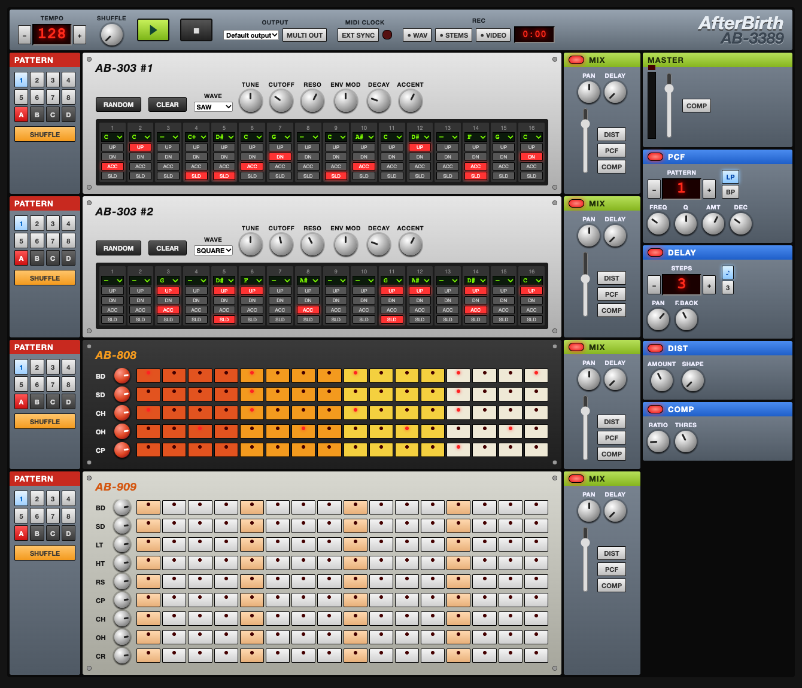

# AfterBirth AB-3389

An acid groovebox that runs in the browser: two TB-303-style bass lines, 808- and 909-style drum machines, a mixer and effects, all built on the Web Audio API alone. TypeScript + Vite, no runtime dependencies.

**▶ Play in your browser: https://verytired.github.io/afterbirth/**

**🎬 Demo:** the ACID TRIP song preset, start to finish — [watch on YouTube](https://www.youtube.com/watch?v=M-HQHGlID6c)

[](https://www.youtube.com/watch?v=M-HQHGlID6c)



## Getting started

```sh
npm install
npm run dev     # http://localhost:5173
```

Press ▶ to start (browsers keep audio suspended until the first click). Chrome / Edge recommended.

## Units

| Unit | What it does |
|---|---|
| **AB-303 #1 / #2** | ENGINE (WASM / JS / CLASSIC), FILTER (DIODE / LADDER), MODS (see below), SAW / SQUARE, TUNE / CUTOFF / RESO / ENV MOD / DECAY / ACCENT. 16 steps with note, UP / DN, ACC (accent) and SLD (slide) |
| **AB-808** | BD / SD / CH / OH / CP. Fully synthesized; CH chokes OH |
| **AB-909** | BD / SD / LT / HT / RS / CP / CH / OH / CR |
| **PATTERN** | 32 patterns per machine (1-8 × A-D). Switching while playing waits for the next bar. SHUFFLE on/off per pattern |
| **SONG** | Pattern chain as text, one row per line: one slot per machine (303#1 303#2 808 909, `-` keeps) and `xN` bars; a line `END` stops the song (and any running recording) instead of looping. ● AUTO records knob moves while the song plays (latched per knob). ACID TRIP loads a ~6 minute Hardfloor-style acid track into bank D |
| **MIX** | Mute, PAN, DELAY send, fader, DIST / PCF / COMP inserts |
| **MASTER** | Meter, master fader, master COMP |
| **PCF** | Pattern-controlled filter. 32 patterns, LP / BP, FREQ / Q / AMT / DEC |
| **DELAY** | Tempo-synced (steps, straight / triplet), PAN, F.BACK |
| **DIST** | AMOUNT, SHAPE (soft clip to wavefold) |
| **COMP** | RATIO, THRES |

- Drag knobs up/down to turn them, double-click to reset. Arrow keys work when a knob has focus
- LED displays such as TEMPO change with −/+, the mouse wheel, or a vertical drag
- Patterns autosave to localStorage (knob and mixer values are not saved)

## 303 voice engine

Each AB-303 voice runs in an AudioWorklet: a PolyBLEP oscillator into a nonlinear 4-pole filter (zero-delay feedback, saturated input, 2× oversampled), with the filter/amp envelopes, slide and an accent sweep that opens the filter further on consecutive accents.

**FILTER** picks the filter model:

| FILTER | Model |
|---|---|
| **DIODE** (default) | TB-303-style diode ladder: coupled stages, about -12 to -18 dB/oct near cutoff steepening to -24 above, resonance thins the bass |
| **LADDER** | Transistor (Moog-style) ladder: four identical stages, -24 dB/oct |

### MODS

A second row of controls inspired by the Devil Fish modification of the TB-303 (an independent fan implementation, not affiliated with its creator). Every default reproduces the stock voice exactly; a unit test checks the output against v0.5 sample by sample. WASM / JS engines only.

| Knob | What it does |
|---|---|
| **ACC DEC** | Filter decay of accented notes, 16 ms to 3 s, max = no decay (stock: short and fixed) |
| **VEG DEC** | Volume decay while a note is held; max = hold (stock) |
| **SOFT ATK** | Attack time of non-accented notes |
| **SLIDE** | Slide time, up to 5× the stock length |
| **SWEEP** | Accent sweep speed: how fast the extra filter opening from consecutive accents fades |
| **FILTER FM** | Cutoff modulated at audio rate by the voice's own output |
| **TRACK** | Cutoff follows the note pitch (1 = full tracking) |
| **DRIVE** | Gain into the filter, up to 66.6× |
| **MUFFLER** | Soft clipping on the output: OFF / SOFT / HARD |
| **SELF OSC** | Lets RESO push the filter into self-oscillation (use TRACK to play it in tune) |
| **DBS A / B** | Dynamic Bank Switching: while the chosen drum part hits on a step, or while the button is held, that step is read from the pattern with bit A / B of its number flipped (A1 ↔ A2 / A3) |

**DEMO** in the top bar loads a scene that shows the MODS off: **DBS** (writes a contrasting phrase into AB-303 #1 pattern A2 and triggers DBS A from the 808 kick), **SELF OSC** (AB-303 #2 self-oscillating and tracking the notes), **DEVIL FISH** (overdriven, muffled AB-303 #1), and **STOCK** to restore every 303 control. Note that the DBS scene overwrites AB-303 #1 pattern A2.

The stock panel also gets the Devil Fish ranges: **ENV MOD** goes to 3× the stock maximum, and **DECAY** stretches from 15 ms to 3 s with the far right position holding the filter open. Both keep their stock sound at the default position.

The same DSP exists twice, selectable per machine with **ENGINE**:

| ENGINE | What runs |
|---|---|
| **WASM** (default) | `assembly/index.ts`, compiled to WebAssembly with AssemblyScript |
| **JS** | `src/dsp/engine.ts`. Used automatically if the WASM build cannot load |
| **CLASSIC** | The original Web Audio graph (OscillatorNode + two BiquadFilters), kept for comparison |

WASM and JS are kept in sync by a unit test that renders both from the same note/knob events and requires them to match, for both filters. The startup ENGINE and FILTER are set in `src/config.ts`.

## Using it with Ableton Live

### MIDI clock sync (Live → AB)

1. Enable the IAC Driver in Audio MIDI Setup
2. In Live's Preferences → Link/Tempo/MIDI, turn on **Sync** for the IAC output
3. Press **EXT SYNC** in AB and allow MIDI access
4. Hit play in Live and AB follows (Start / Stop / Continue / Song Position supported, tempo follows automatically)

If timing drifts, adjust Live's **MIDI Clock Sync Delay**.

### Recording audio into a DAW (AB → Live)

1. Install [BlackHole 16ch](https://github.com/ExistentialAudio/BlackHole) (`brew install blackhole-16ch`)
2. Choose BlackHole 16ch under **OUTPUT** in AB (the first time, the browser asks for microphone permission just to show device names; nothing is recorded)
3. Turn on **MULTI OUT**

| ch | Content |
|---|---|
| 1/2 | MASTER (including DELAY and master COMP) |
| 3/4 | AB-303 #1 |
| 5/6 | AB-303 #2 |
| 7/8 | AB-808 |
| 9/10 | AB-909 |

4. In Live, set the input device to BlackHole 16ch, route each track's input to Ext. In 3/4 and so on, and record

Per-machine outputs are taken after the fader and inserts (DIST / PCF / COMP). DELAY and master COMP are only on 1/2. Output device switching works in Chrome / Edge only.

## Recording and video

From **REC** in the top bar.

- **● WAV**: records MASTER (post-fader) as a 16-bit stereo WAV. Press again to stop and download `afterbirth-YYYYMMDD-HHMMSS.wav`, ready to drop into a DAW
- **● STEMS**: records MASTER, each machine and the delay return at the same time, sample-aligned, and downloads them as a zip (`00-master.wav`, `01-ab-303-1.wav`, … `05-delay-return.wav`). Machine stems are post-fader/inserts with the same -6dB master trim, so the stems sum back to the mix before master COMP / master fader
- **● VIDEO**: pick the AB tab in the screen-share dialog to record the screen together with MASTER audio. Press again, or stop sharing, to finish. mp4 in Chrome, webm elsewhere
- Recordings are buffered in memory, so long takes are not a good fit (about 200MB per 10 minutes per stereo track; STEMS records six)

## Development

| Command | What it does |
|---|---|
| `npm run dev` | Dev server with hot reload |
| `npm run typecheck` | TypeScript type check |
| `npm test` | Unit tests (Vitest): helpers in `src/lib.ts`, and the 303 engine (determinism, stability at max settings, WASM output matching JS) |
| `npm run e2e` | Builds, then drives the production build in Chrome with Playwright: playback level, pattern banks, MIDI clock, WAV and stem export (stems must sum back to MASTER), engine switching, fallback to JS when the WASM file is blocked |
| `npm run check` | All of the above |

Code lives in `src/`: `tb303.ts` and `drums.ts` (machines), `dsp/` (303 voice engine and its AudioWorklet), `audio.ts` (effects, master, mixer), `transport.ts`, `midi.ts`, `record.ts`, `output.ts`, wired together in `main.ts`. The AssemblyScript port of the engine is in `assembly/`; `npm run dev`, `build` and `test` compile it to `src/dsp/voice.wasm` first.

### CI and releases

GitHub Actions runs the type check, unit tests and Playwright tests on every push and pull request. GitHub Pages is deployed from `main` only after they pass.

Releases are created by CI too. Do not create them by hand; push an annotated tag and the release (with the tag message as notes) appears once the checks pass:

```sh
git tag -a v0.4 -m "Release notes here"
git push origin v0.4
```

## License

[MIT](LICENSE)

## Disclaimer

An unofficial fan project inspired by ReBirth RB-338. Not affiliated with Reason Studios (formerly Propellerhead Software) or Roland. 303 / 808 / 909 are used only to describe the style of each machine.
